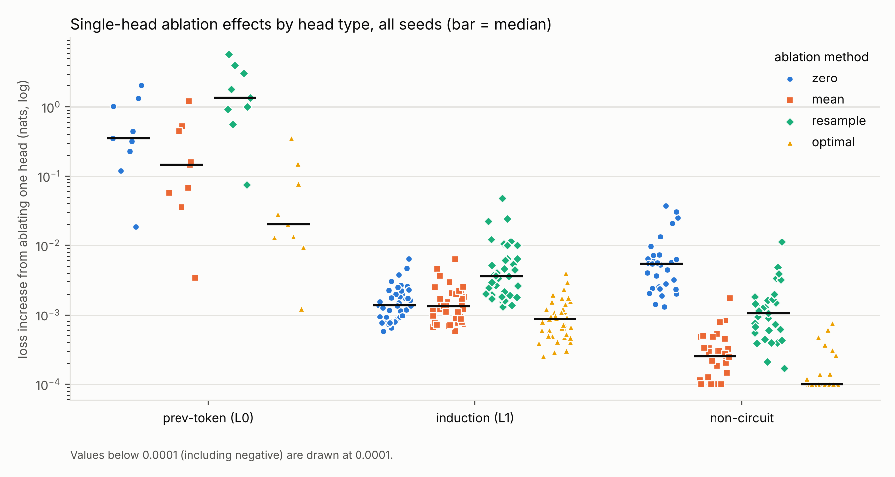
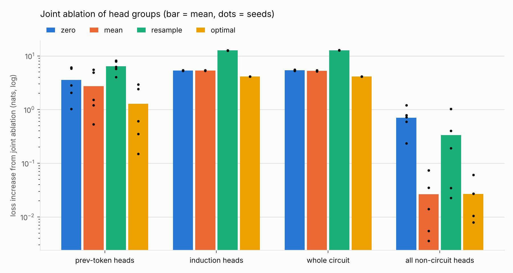

# Q1: Do ablation methods agree on which heads matter?

**Question.** Zero, mean, resample and optimal-constant ablation are all used to decide
which attention heads matter for a behaviour. Do they agree, and which of them recovers
a circuit we know to be correct?

**Short answer.** Mean, resample and optimal ablation agree on *which* heads matter and
recover the known circuit well. Zero ablation does not: it ranks heads worse than chance,
because it mistakes idle heads with large constant outputs for important ones. Even the
methods that agree on rankings disagree on effect sizes by more than an order of magnitude.
And none of them, applied one head at a time, notices the induction heads at all, because
those heads back each other up.

## Setup

Full details in [`docs/SCOPE.md`](../../docs/SCOPE.md).

* **Models.** 5 seeds of a 2-layer, 8-heads-per-layer, attention-only transformer
  (d_model 64, pre-LayerNorm), trained for 1,500 steps on a 50/50 mixture of
  *induction* (periodic random token sequences with a random period) and *two-back*
  (predict the token two positions back). Every model reaches ≥ 99.99% accuracy on both.
* **Reference circuit, without ablation.** From attention patterns on induction inputs:
  layer-0 heads with previous-token score > 0.3, and layer-1 heads with induction score
  > 0.3. Across seeds that is 1–3 previous-token heads and all 8 layer-1 heads
  (49 circuit heads and 31 non-circuit heads in total). The non-circuit heads are
  layer-0 heads that mostly do nothing on induction inputs.
* **Ablations.** Each head's output is replaced by: zero; its per-position mean over
  4,096 induction sequences; its output on a different induction sequence (resample);
  or the per-position constant that minimises loss (optimal, fitted by gradient descent).
* **Metric.** Increase in induction loss in nats, measured on 2,048 held-out sequences
  with 95% bootstrap CIs. Clean loss is about 0.001; a model that knows nothing scores
  4.13 (uniform over the 62 content tokens).

Numbers: [`summary.md`](summary.md) (with per-seed, per-head tables and CIs),
[`summary.json`](summary.json), raw per-seed results in `seed*.json`.

## Findings

### 1. Zero ablation ranks heads worse than chance; the other three agree

Rank agreement of the 16 single-head effects (Spearman ρ, mean ± sd over 5 seeds):

| | mean | resample | optimal |
|---|---|---|---|
| **zero** | 0.11 ± 0.13 | 0.24 ± 0.13 | 0.10 ± 0.21 |
| **mean** | | 0.95 ± 0.03 | 0.92 ± 0.06 |
| **resample** | | | 0.87 ± 0.07 |

How well each method separates circuit heads from non-circuit heads:

| method | AUROC | precision@k |
|---|---|---|
| zero | **0.25 ± 0.11** | 0.42 ± 0.15 |
| mean | 0.97 ± 0.05 | 0.96 ± 0.06 |
| resample | 0.90 ± 0.05 | 0.85 ± 0.07 |
| optimal | 0.98 ± 0.03 | 0.94 ± 0.10 |

An AUROC of 0.25 means zero ablation usually rates a non-circuit head *above* a circuit
head. The figure shows why. Zero-ablating an idle non-circuit head costs a median 0.005
nats, which is more than zero-ablating a real induction head (0.0014). Mean ablation
says the idle heads cost 0.0003, five times less than the induction heads.



### 2. Zero ablation's error is predicted by how constant a head's output is

Define a head's *constant fraction* as |mean output| / (|mean output| + mean |deviation
from the mean|). Across all 80 heads, the ratio of zero-ablation to mean-ablation effect
tracks it closely: **ρ = 0.90**. The non-circuit heads' outputs are mostly constant
(median constant fraction 0.68, against 0.30 for all heads). Zero ablation removes that
constant along with any information, pushing the residual stream somewhere it never
goes in training. Mean ablation removes only the information.

For the induction heads, whose outputs are mostly input-dependent, zero and mean agree
(ratio 1.04 ± 0.02). Zero ablation is not wrong everywhere; it is wrong exactly where a
head carries a large constant. That is cheap to check before trusting it. The proposed
mechanism (LayerNorm rescaling) is Q2.

### 3. Agreeing on rankings ≠ agreeing on magnitudes

Median effect relative to mean ablation, per circuit head (mean ± sd over seeds):

| method | prev-token heads | induction heads |
|---|---|---|
| zero / mean | 2.8 ± 1.2 | 1.04 ± 0.02 |
| resample / mean | **10.3 ± 5.2** | 2.6 ± 0.1 |
| optimal / mean | **0.24 ± 0.06** | 0.63 ± 0.07 |

For the same previous-token head, resample and optimal ablation differ by about 40×.
A claim like "this head accounts for N% of the behaviour" is meaningless without the
method attached. The methods answer different counterfactuals:

* **resample**: "what if this head reported a *wrong but plausible* value?" Induction
  heads act on the wrong previous token and confidently copy the wrong answer.
  Ablating the whole circuit this way costs 12.7 nats, three times worse than chance.
* **optimal**: "what if this head's information were simply unavailable, and the model
  got the best possible stand-in?" Ablating the whole circuit costs 4.13 nats, exactly
  chance, as it should if all task information is gone.
* **mean** sits in between. It is a constant, so it removes information, but not the
  best constant: for previous-token heads it costs about 4× the optimal constant.



### 4. Joint ablation exposes zero ablation's false positives; resample has a milder version

Ablating *all* non-circuit heads together, as a fraction of ablating the whole circuit:

| method | non-circuit / circuit |
|---|---|
| zero | **13.2% ± 6.7%** (0.71 nats) |
| mean | 0.5% ± 0.6% |
| resample | 2.7% ± 3.3% (0.02–1.03 nats across seeds) |
| optimal | 0.6% ± 0.5% |

One at a time, zero ablation's false positives are small (no non-circuit head passes a
1% threshold). Together they cost 0.7 nats, a non-trivial chunk of the behaviour, from
heads that do nothing for induction.

Resample's non-circuit effect varies a lot by seed. It is driven by how much those
heads attend to the previous token (ρ = 0.47 over 31 heads). Some "non-circuit" heads
have previous-token scores of 0.2–0.27, just under the circuit threshold, so they carry
a weak copy of the signal the induction heads read. Removing it (mean, optimal) barely
matters. Replacing it with a wrong value (resample) misleads the induction heads.
Whether that makes those heads "part of the circuit" depends on which counterfactual you
care about. The reference circuit is a threshold on a graded property, and resample
probes the fuzzy edge of it.

### 5. Single-head ablation of any kind misses the induction heads (redundancy)

Under a common rule ("a head matters if its effect exceeds 1% of the full-circuit
effect"), **every method misses every induction head in every seed** (8/8 per seed).
Single induction heads cost 0.0006–0.05 nats depending on method, yet ablating all eight
costs 5.3 nats (mean). With 8 heads doing the same job, removing one leaves 7 to carry it. Q4 will
measure this directly with pairwise and nested joint ablations.

### 6. Smaller observations

* **Mean ablation is not always gentler than zero.** Ablating all of layer 0 costs
  6.66 nats with mean and 6.19 with zero (mean is worse in 5/5 seeds). We have not yet
  checked why; it goes on the Q2 list alongside the LayerNorm mechanism.
* **Seeds differ in how the previous-token role is split** (1 to 3 heads). Seed 3 puts
  it all in one head (single-head mean effect 1.2 nats). Seed 4 spreads it over three,
  each with a small effect (0.003–0.07 nats). One of those (head 0.3, score 0.30) sits
  exactly at the circuit threshold. The method ordering above holds in every seed.

## Recommendations

1. **Don't use zero ablation for head attribution** unless you have checked that the
   head's output has a small constant component. If you do use it, compute the constant
   fraction (one forward pass) and expect false positives where it is high.
2. **Always report effect sizes with the method named.** Pick the method that matches
   the counterfactual you mean: optimal (or mean) for "is this information needed?",
   resample for "does the model rely on this being correct?".
3. **Complement single-component ablations with group ablations.** Single ablations miss
   redundant components (finding 5), and group ablations reveal false positives that are
   invisible one at a time (finding 4).

## Caveats

* Toy setting: 2 layers, attention-only, synthetic tasks, CPU-sized models. These
  findings show the failure modes *exist* and are large, not that pretrained models have
  them to the same degree.
* The reference circuit is a threshold (0.3) on attention scores. Heads with
  previous-token scores of 0.2–0.3 are borderline; finding 4 depends partly on them.
* The models are very confident (clean loss about 0.001), so small effects sit in a
  saturated regime of the loss.
* Optimal-ablation constants are fitted with 300 Adam steps. They should never do worse
  than the mean; the worst observed excess is +0.0007 nats for single heads and +0.013
  nats for groups. Treat optimal-ablation effects below about 0.01 nats as noise.
* Mean and resample references come from induction inputs only. Using the training
  mixture instead is a natural variant (Q6).

## Reproduce

```bash
pip install -e '.[dev]'
bash experiments/run_q1.sh 5        # reuses checkpoints in results/q1/models/ if present
```

Training takes about 1.5 minutes per seed with 4 threads. The ablations then take about
5.5 minutes per seed with 3 threads, or about 14 minutes each with 4 seeds running in
parallel on 4 cores. Peak memory is about 2.5 GB per seed.
