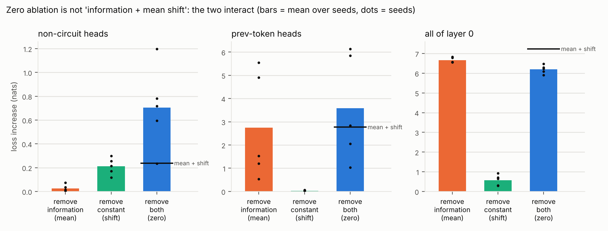
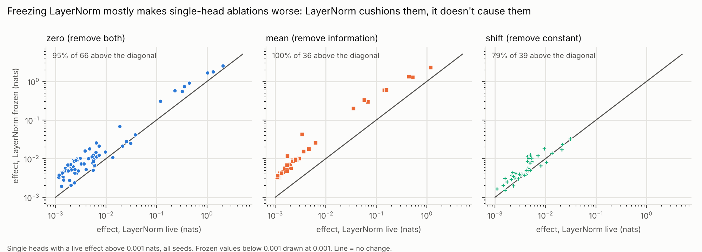
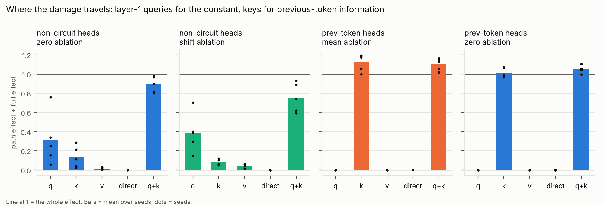

# Q2: How much of a zero-ablation effect is the mean shift rather than information?

**Question.** Q1 found that zero ablation misranks heads, and that its divergence from mean
ablation tracks how constant a head's output is. The natural reading is that zero ablation
= (losing the information) + (losing the constant, which pushes activations off-distribution).
How much of a zero-ablation effect is each, and what carries the damage?

**Short answer.** The question assumes the two parts add up, and they don't.

* **Removing the constant alone does little.** For the idle non-circuit heads it accounts
  for only 31% of zero ablation's excess over mean ablation; for previous-token heads, 4%.
  Most of the excess appears only when the constant and the information are removed
  *together* (positive interaction in 5/5 seeds; 39 of 40 single layer-0 heads).
* **LayerNorm is not the culprit.** It cushions single-head ablations: freezing it at its
  clean scale makes 95% of zero ablations and 100% of mean ablations *worse*. It amplifies
  only when an ablation removes almost all the useful signal, which explains the Q1 puzzle
  of mean ablation beating zero on all of layer 0.
* **The damage has specific routes.** The idle heads' constant acts through layer-1
  queries (with keys). The previous-token heads' information acts entirely through layer-1
  keys, the textbook induction mechanism, confirmed causally here.

## Design

Same 5 models, data streams and reference circuit as Q1 ([`docs/SCOPE.md`](../../docs/SCOPE.md)).
Write a head's output as r = μ + ε: the per-position mean μ plus the input-dependent
deviation ε. A 2×2 design:

| ablation | replaces r with | removes |
|---|---|---|
| mean | μ | the information ε |
| shift | ε | the constant μ |
| zero | 0 | both |

Interaction = zero − mean − shift. The Shapley share of the constant (its average marginal
contribution over the two orders) is ½[shift + (zero − mean)] / zero.

Each ablation is also run (a) with **every LayerNorm frozen** at its clean-run scale, so the
ablation can change the residual stream's direction but not its norm, and (b) for layer-0
heads, **path-specifically**: the change reaches only the layer-1 queries, keys, values, or
the unembedding directly. In a 2-layer model, all four paths together reproduce the full
ablation exactly (tested in `tests/test_core.py`).

The zero and mean numbers reproduce Q1 exactly (same evaluation sequences). Full tables:
[`summary.md`](summary.md); per-seed data in `seed*.json`.

## Findings

### 1. Zero ≠ information + constant: the two interact



Effects in nats (mean ± sd over 5 seeds):

| ablated together | zero | mean (info) | shift (constant) | interaction | constant's Shapley share |
|---|---|---|---|---|---|
| all non-circuit heads | 0.71 ± 0.35 | 0.026 ± 0.029 | 0.21 ± 0.07 | **+0.47 ± 0.30** | 66% |
| previous-token heads | 3.58 ± 2.30 | 2.74 ± 2.31 | 0.031 ± 0.027 | **+0.81 ± 0.32** | 17% |
| induction heads | 5.34 ± 0.06 | 5.34 ± 0.05 | 0.000 | 0.00 ± 0.04 | 0% |
| all of layer 0 | 6.19 ± 0.21 | 6.66 ± 0.14 | 0.58 ± 0.28 | **−1.04 ± 0.26** | 1% |

Single heads (median over heads pooled across seeds): constant's Shapley share is **83%**
for idle non-circuit heads (n = 31), **34%** for previous-token heads (n = 9), and **2%**
for induction heads (n = 40).

So "how much is the mean shift" has an order-dependent answer:

* **Idle heads.** Removing the constant alone costs 0.21 nats, and removing their
  information alone costs 0.03. Removing both costs 0.71, three times the sum. The idle
  heads' small input-dependent signal (Q1: weak previous-token attention) is harmless to
  lose while the constant is in place, and costly once it isn't.
* **Previous-token heads.** Their constant alone is almost irrelevant (0.03 nats). But
  zero ablation costs 0.84 nats more than mean ablation, and that excess is nearly all
  interaction. With the information gone, the constant still matters.
* **Induction heads.** Their outputs are almost entirely input-dependent, so zero and
  mean ablation agree (as Q1 found) and there is nothing to decompose.
* **All of layer 0.** The interaction turns *negative*: the loss is already near its
  ceiling, so the second removal adds less.

**Why superadditive? A working explanation.** The clean model is saturated (loss about
0.001; 88% of induction-head attention on the answer key). One small perturbation is
absorbed by that margin; two together exhaust it. The diagnostics fit this. For the idle
heads, the drops in answer-key attention roughly add up: 0.09 (mean) + 0.17 (shift) =
0.26, against 0.31 observed for zero. The *loss* does not add up (0.24 vs 0.71), because
loss is a steeply convex function of that attention near saturation. Far from the clean
point (all of layer 0) the curve flattens and the interaction flips sign. We have not
tested this explanation directly; Q4 measures interactions between heads and is the
natural place to check it.

### 2. LayerNorm cushions ablations; it amplifies only when the signal is gone



Effect with LayerNorm frozen ÷ effect with it live (single heads with live effect > 0.001
nats, median [IQR]):

| head type | zero | mean | shift |
|---|---|---|---|
| previous-token (n = 9) | 2.0 [1.6, 2.5] | 4.1 [3.0, 5.6] | 1.9 [1.6, 2.2] |
| induction (n = 26) | 3.4 [3.0, 3.7] | 3.4 [3.0, 3.8] | – |
| idle non-circuit (n = 31; shift n = 30) | 1.6 [1.1, 2.1] | – | 1.2 [1.0, 1.5] |

Freezing LayerNorm makes **95%** of single-head zero ablations, **100%** of mean ablations
and **79%** of shift ablations worse. The original hypothesis (LayerNorm rescaling creates
zero ablation's excess) is refuted. When one head goes, the residual stream's norm
changes and LayerNorm rescales what remains, including the seven other induction heads
doing the same job. That rescaling compensates, a form of self-repair; Rushing & Nanda
(2024) attribute part of self-repair in real LMs to LayerNorm. Q3 will measure this
directly.

The same rescaling **backfires when an ablation removes almost all the useful signal**.
Ablating all induction heads at once shrinks the final residual to 0.30× its clean scale;
LayerNorm scales the remains back up, and the model is confidently wrong. With LayerNorm
frozen, it falls back towards uniform (output entropy 4.0 nats) and the loss is 21%
lower (ratio 0.79).

**This resolves the Q1 layer-0 puzzle.** Mean-ablating all of layer 0 removes every head's
deviation ε, which shrinks the layer-1 residual to 0.86× and the final residual to 0.69×
of clean scale. Zero ablation leaves them at 1.04× and 0.89×. LayerNorm therefore
amplifies the now-uninformative signal more under mean ablation. The model becomes more
confident (output entropy 1.07 vs 1.75 nats) while equally wrong: answer-key attention is
0.06 under both, against 0.88 clean. Freeze LayerNorm and the order flips in **5/5 seeds**:
mean 4.93 vs zero 5.90 nats on average, against 6.66 vs 6.19 live.

### 3. Where the damage travels



Path effect as a fraction of the full effect (mean ± sd over seeds):

| ablated | method | q only | k only | v only | direct | q + k |
|---|---|---|---|---|---|---|
| idle heads | shift (constant) | **0.39 ± 0.20** | 0.08 ± 0.03 | 0.04 | 0.00 | 0.75 ± 0.15 |
| idle heads | zero | 0.31 ± 0.27 | 0.14 ± 0.11 | 0.01 | 0.00 | 0.89 ± 0.08 |
| previous-token heads | mean (info) | 0.00 | **1.12 ± 0.09** | 0.00 | 0.00 | 1.10 ± 0.06 |
| previous-token heads | zero | 0.00 | **1.01 ± 0.05** | 0.00 | 0.00 | 1.05 ± 0.04 |

* **Previous-token information acts only through layer-1 keys.** That is the textbook
  K-composition: the induction head's key at position s must say "the previous token was
  X". Here it is confirmed causally, not inferred from weights. (The keys-only effect
  slightly exceeds the full effect: the accompanying change to the queries offsets a
  little of the damage.)
* **The idle heads' constant acts mainly through layer-1 queries**, and fully only when
  queries and keys are perturbed together (q alone 0.39 and k alone 0.08 sum to 0.47,
  against 0.75 jointly). Superadditivity again. The values and the direct path to the
  unembedding play no part.

### 4. What predicts the constant's damage

Spearman ρ, pooled over seeds:

| heads | target | size of mean output | how far it moves layer-1 **queries** | … **keys** | … **values** |
|---|---|---|---|---|---|
| idle (n = 31) | shift effect | 0.60 | **0.74** | 0.60 | 0.49 |
| all layer 0 (n = 40) | zero − mean | 0.76 | 0.50 | **0.81** | 0.51 |

A head's mean output predicts its damage better when measured as *how far it moves the
inputs that matter*. For idle heads that is the layer-1 queries; for the full set including
previous-token heads it is the keys, consistent with the path results. Both "moves"
estimates are first-order (through the clean LayerNorm scale), so this is a cheap
screening statistic, not a substitute for running the ablation.

## Verdicts on the Q2 hypotheses

| hypothesis (from `SCOPE.md`) | verdict |
|---|---|
| zero − mean is the cost of the mean shift | **Mostly no.** The shift alone is 31% of zero − mean for idle heads and 4% for previous-token heads; the rest is interaction. |
| it is predicted by the norm of the head's mean output | **Partly** (ρ = 0.60–0.76). How far the mean moves the relevant layer-1 reads predicts as well or better. |
| it is mediated by LayerNorm rescaling | **No.** LayerNorm cushions single-head ablations; it amplifies only when nearly all signal is removed. |

## What this means in practice

1. **Don't read zero − mean as "the cost of the off-distribution shift".** Run the shift
   ablation (r → r − μ) directly. It is one extra forward pass.
2. **Expect ablation effects to be non-additive in saturated models.** Decompositions of
   the form "X% due to A, Y% due to B" depend on order. Report both orders, or a Shapley
   split, and say which.
3. **Freezing LayerNorm is not a neutral "cleaner" ablation.** It switches off a
   compensation mechanism: single-head effects grow 1.2–4×, while large group ablations
   shrink. State which you use.
4. **Path-specific ablation is a cheap causal check of a hypothesised mechanism.** Here it
   confirmed K-composition in one line of output.

## Caveats

* Same toy setting as Q1: 2-layer attention-only models on synthetic tasks, clean loss
  about 0.001. The saturation that drives the interactions may be weaker in real LMs,
  where losses are far from zero.
* The Shapley split has only two players and is one convention among several; the raw
  2×2 numbers are in [`summary.md`](summary.md).
* Frozen LayerNorm fixes *all* LayerNorm scales at once. Freezing only the final or only
  the layer-1 LayerNorm would separate their roles.
* In a 2-layer model, path effects are exact; in deeper models they measure direct paths
  only.
* The idle heads' LayerNorm ratio under mean ablation rests on one head; mean ablation of
  the others is too small (< 0.001 nats) to give a meaningful ratio.

## Reproduce

```bash
pip install -e '.[dev]'
bash experiments/run_q2.sh 5     # needs the Q1 checkpoints in results/q1/models/
```

About 9–14 minutes per seed with 2–4 threads, and about 2.7 GB of memory per seed.
