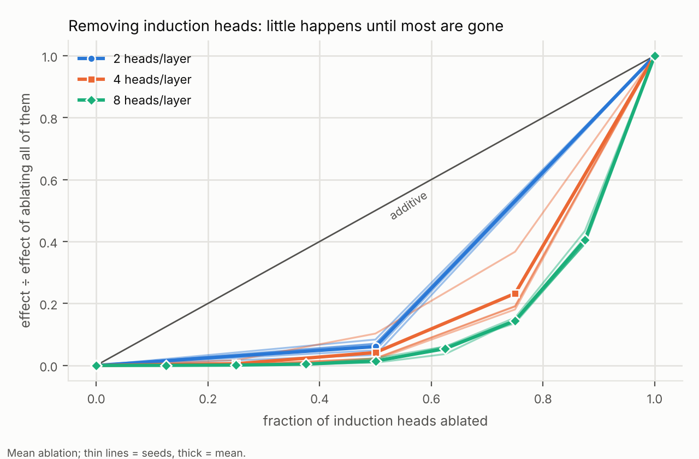
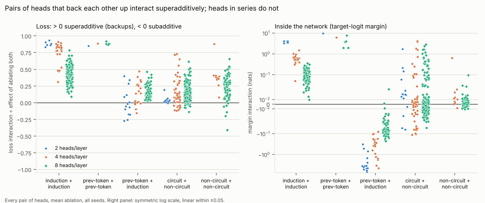
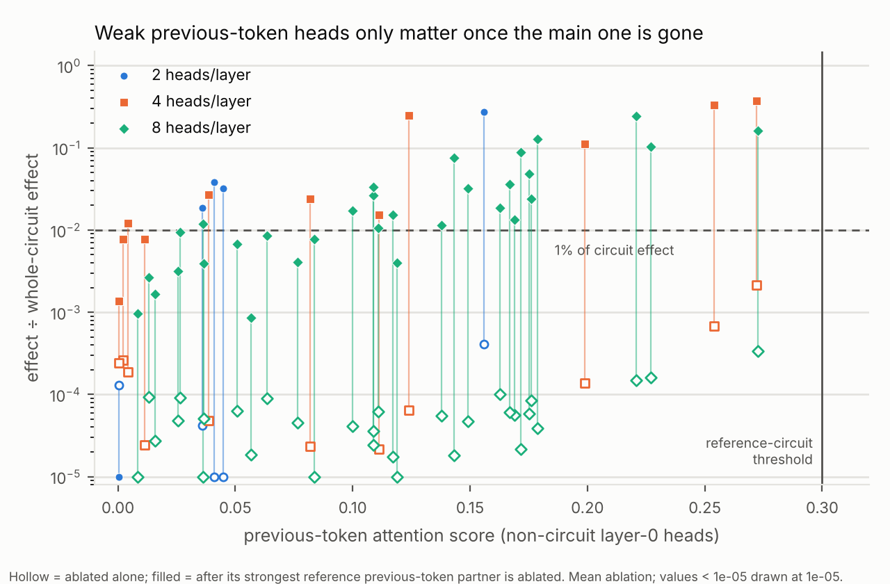

# Q4: Does single-component ablation miss components that only matter jointly?

**Question.** Q1 found that in the 8-head models no single induction head passes a
1%-of-circuit threshold under any ablation method, while the 8 together account for the
whole circuit effect. Is that redundancy, and how does it scale with the number of heads
that can back each other up? Which heads does one-at-a-time ablation miss, and does
testing pairs fix it?

**Short answer.** Yes, single-head ablation misses components that only matter jointly, and the miss grows with redundancy. Testing pairs does not fix it.

* **Single-head ablation loses the induction heads as their number grows.**
  * At a 1%-of-circuit threshold it finds 100% of them with 2 heads per layer, 12% with 4, and 0% with 8 (mean ablation).
  * Even where it finds them, it understates them. Single-head effects sum to 12% (2 heads), 2.2% (4) and 0.2% (8) of the effect of ablating all the induction heads together.
* **Little happens until most heads are gone, yet no single head is enough.**
  * In the 8-head models, removing 4 of the 8 induction heads (random subsets) costs 1–2% of removing all 8 on average. Removing 5 stays under 10% in every seed.
  * Keeping only one and ablating the other 7 still leaves 41% of the damage.
* **Backup pairs are superadditive, as predicted, but pairs don't rescue the analysis.**
  * Every induction + induction pair has a significantly positive interaction, in every model under both methods. It lives mostly in the logit margins: loss curvature explains a median of only 24–33%.
  * But singles plus *every* pairwise interaction still recover only 21% (4 heads) and 2% (8 heads) of the joint effect. The importance sits in higher-order interactions.
* **Serial pairs are subadditive in the margin, but the loss can show the opposite sign.**
  * Previous-token + induction pairs have a negative margin interaction in 97–100% of cases, as predicted.
  * In the loss, the same pairs are significantly *super*additive in 80% (4 heads) and 100% (8 heads) of cases under mean ablation, because the convex, saturated loss overturns the margin effect.
  * The sign of an interaction depends on the metric.
* **One-at-a-time ablation also misses heads outside the reference circuit.** These are layer-0 heads with weak previous-token attention (score 0.1–0.3, under the reference threshold).
  * Alone, each does almost nothing (median 0.006% of the circuit effect; none passes 1%).
  * Once the main previous-token head is ablated, 24 of 25 pass 1%, up to 37% of the circuit effect.
  * How much they matter tracks their previous-token score (Spearman ρ 0.86–0.95).
  * They are hidden backups: neither single ablation nor the attention-pattern reference circuit flags them.

## Design

Same tasks, recipe, data streams and reference circuit as Q1
([`docs/SCOPE.md`](../../docs/SCOPE.md)), with 2, 4 or 8 heads per layer (d_head 16, so
the model gets narrower with fewer heads).

* **Models.**
  * 8 heads/layer: the five Q1 checkpoints.
  * 2 and 4 heads/layer: trained here *to criterion*. That means at least 1,500 steps (the Q1 budget), then a check every 250 steps until both tasks reach 99% held-out accuracy, up to 10,000 steps.
  * The learning rate is constant after warmup, so a model that stops at 1,500 steps is trained exactly as in Q1.
* **Who learned induction.**
  * Every model that met the criterion did so at the first check (1,500 steps).
  * None of the 5 that missed it recovered by 10,000 steps; their induction accuracy reached only 36–79%.
  * Narrow models often stay stuck on the induction plateau. 4 of 5 four-head models met the criterion, but only 1 of 5 two-head models did.
  * To get more usable 2-head models I added seeds 5–34. Because of the pattern above, these were capped at 1,500 steps. In total 6 of 35 two-head models met the criterion; the others stayed on the plateau (17–35% induction accuracy at 1,500 steps).
* **Excluded.**
  * Models that missed the criterion: they never fully learned induction, and most have no previous-token head.
  * 1 head per layer: it never learns induction (53% after 5,000 steps).
* **Usable models:** 6 × 2 heads, 4 × 4 heads, 5 × 8 heads. Every usable model has all of layer 1 as induction heads, plus 1–3 reference previous-token heads in layer 0.
* **Measured per model.** Mean ablation is primary; resample is a robustness check.
  * every single head
  * every pair of heads
  * groups (circuit, induction heads, previous-token heads, layer 1)
  * nested ablation of k of the n induction heads, for every k (all subsets, or 10 random ones when there are more)
  * sufficiency: keep one head of a kind and ablate the rest of that kind
* **Interaction** of a pair = effect(A and B) − effect(A) − effect(B), with a 95% bootstrap CI over sequences.
  * Positive (superadditive) means the heads back each other up: each covers for the other, so losing both is worse than the sum.
  * Negative (subadditive) means the heads work in series: once one is gone, the other has less left to break.
* **Margin test.** The same interaction measured on the target-logit margin m (loss = softplus(−m)). It separates interactions inside the network from interactions created by the loss's curvature.
  * "Explained by curvature" is the loss interaction you would get if the pair's margin drops simply added, divided by the actual loss interaction.

## Findings

### 1. Single-head ablation loses circuit heads as redundancy grows

Recall is the share of circuit heads whose single-head effect exceeds 1% of the whole-circuit effect. "÷ group" compares with ablating all heads of that kind together. "+ pairs" adds every pairwise interaction among the induction heads to the singles (second-order inclusion–exclusion).

| heads/layer | method | recall: induction heads | median single ÷ group | Σ singles ÷ group | Σ singles + pairs ÷ group | recall: prev-token heads |
|---|---|---|---|---|---|---|
| 2 | mean | 1.00 | 0.060 | 0.12 ± 0.04 | 1.00 (exact) | 1.00 |
| 4 | mean | 0.12 ± 0.25 | 0.001 | 0.022 ± 0.030 | 0.21 ± 0.18 | 1.00 |
| 8 | mean | **0.00** | 0.000 | 0.002 ± 0.001 | **0.020 ± 0.006** | 0.83 ± 0.24 |
| 2 | resample | 1.00 | 0.150 | 0.34 ± 0.03 | 1.00 (exact) | 1.00 |
| 4 | resample | 0.31 ± 0.24 | 0.006 | 0.065 ± 0.075 | 0.81 ± 0.11 | 1.00 |
| 8 | resample | 0.00 | 0.000 | 0.004 ± 0.002 | 0.13 ± 0.04 | 0.93 ± 0.15 |

The induction heads in the 8-head models are not idle. Ablating all of them costs 5.3 nats, more than chance-level loss (4.1). Each one alone costs at most 0.006 nats. A pair test does not close the gap: with 8 heads, the sum of all 28 pairwise interactions is about 9× the sum of singles, but together they still reach only 2% of the joint effect.

The previous-token heads are mostly found, because the reference circuit has only 1–3 of
them per model. Section 5 shows that this count is itself an undercount.

### 2. Nested ablation: flat until most heads are gone



The table shows the effect of removing k of the n induction heads (mean over subsets) as a share of removing all n. It gives the per-seed range and how much of the induction set can go before the effect passes 10%.

| heads/layer | remove ¼ | remove ½ | remove ¾ | remove all but one | can remove before 10% |
|---|---|---|---|---|---|
| 2 | – | 0.03–0.08 | – | 0.03–0.08 (same as ½) | 50% |
| 4 | 0.001–0.017 | 0.02–0.10 | 0.18–0.37 | 0.18–0.37 (same as ¾) | 44% ± 12% |
| 8 | 0.001–0.002 | 0.009–0.023 | 0.14–0.15 | 0.39–0.43 | 62% (5 of 8, every seed) |

The curve sits far below the additive diagonal. It is convex: almost nothing happens, then everything happens. Half the induction heads of an 8-head model can be removed for 1–2% of the cost of removing them all.

### 3. Sufficiency: no single head is enough either

The table gives the effect with one head of a kind kept and the rest ablated, as a share of the effect with none kept: 0 means one head does the whole job, 1 means one head does nothing.

| heads/layer | induction heads | prev-token heads |
|---|---|---|
| 2 | 0.06 ± 0.04 (n = 12) | 0.07 ± 0.05 (n = 2) |
| 4 | 0.23 ± 0.16 (n = 16) | 0.06 ± 0.06 (n = 2) |
| 8 | **0.41 ± 0.12** (n = 40) | 0.10 ± 0.08 (n = 7) |

The more induction heads there are, the less any one of them can do alone. In the 8-head models one head recovers only 59% of the behaviour (1.1–3.3 nats of damage remain), yet a random 4 of the 8 recover about 98%. So this is *distributed* redundancy: the work is spread across all the heads, with slack, rather than one active head plus idle spares. A necessity test (single ablation) and a sufficiency test (keep one) both miss what the heads do together.

### 4. Pair interactions: backups superadditive, serial pairs subadditive in the margin



Mean ablation, all usable models of each size. "Relative" is the interaction divided by the effect of ablating both heads.

| heads/layer | pair type | n | median relative | sig. > 0 | sig. < 0 | margin interaction < 0 | median explained by curvature |
|---|---|---|---|---|---|---|---|
| 2 | induction + induction | 6 | 0.87 | 100% | 0% | 0% | 0.29 |
| 4 | induction + induction | 24 | 0.81 | 100% | 0% | 0% | 0.24 |
| 8 | induction + induction | 140 | 0.44 | 100% | 0% | 0% | 0.33 |
| 2 | prev-token + prev-token | 1 | 0.85 | 100% | 0% | 0% | 0.05 |
| 4 | prev-token + prev-token | 1 | 0.89 | 100% | 0% | 0% | 0.04 |
| 8 | prev-token + prev-token | 5 | 0.88 | 100% | 0% | 0% | 0.05 |
| 2 | prev-token + induction | 14 | −0.04 | 43% | 57% | **100%** | – |
| 4 | prev-token + induction | 20 | 0.16 | 80% | 20% | **100%** | 1.37 |
| 8 | prev-token + induction | 72 | 0.14 | 100% | 0% | **97%** | 1.08 |
| 4 | non-circuit + non-circuit | 10 | 0.38 | 90% | 0% | 10% | 0.60 |
| 8 | non-circuit + non-circuit | 82 | 0.27 | 61% | 0% | 32% | 0.27 |

* **Backups (induction + induction, prev-token + prev-token).** Superadditive in every case, under both methods. The superadditivity is inside the network: the margins compound, and loss curvature accounts for 4–33%. In absolute terms the 8-head pair interactions are tiny (median 0.002 nats). Removing two of eight heads barely matters, so the joint importance lives at higher order (section 1).
* **Series (previous-token + induction).** In the margin, subadditive in 97–100% of pairs, as predicted. Once the previous-token head is gone, the induction head has less useful signal left to lose.
  * In the loss, the sign flips for the 4- and 8-head models.
  * The model is saturated (clean loss ≈ 0.001, so loss ≈ e^(−m)). In that regime two margin drops that add *less* than their sum can still produce a loss increase *greater* than the sum.
  * Curvature "explains" more than 100% of the loss interaction here: by itself it would produce an even larger superadditive interaction, and the margin's subadditivity only partly offsets it.
  * In the 2-head models the margin subadditivity is much larger (median −3.6 nats), and the loss sign splits: 57% of pairs significantly subadditive, 43% superadditive.
* **Everything else.** Near the clean model, most pairs of unrelated heads are mildly superadditive (61–100% significant, median 0.0002–0.002 nats). This is the Q2 lead, confirmed across pair types; curvature explains 27–60% of it.

Resample ablation agrees on the backup pairs (100% superadditive). For serial pairs its margin interaction is negative in 100% of cases, while the loss sign varies (40–62% significantly positive for 4 and 8 heads).

### 5. Hidden backups outside the reference circuit



The reference circuit takes a layer-0 head as a previous-token head if more than 30% of its attention goes to the previous token. Many other layer-0 heads attend to the previous token 10–27% of the time.

| heads/layer | non-circuit layer-0 heads | pass 1% alone | pass 1% after P | hidden (score ≥ 0.1) | hidden (score < 0.1) | ρ(score, interaction with P) |
|---|---|---|---|---|---|---|
| 4 | 11 | 0 | 8 | 5 of 5 | 3 of 6 | 0.95 |
| 8 | 31 | 0 | 19 | 18 of 19 | 1 of 12 | 0.86 |

* "After P" is the head's effect once its strongest reference previous-token partner P is already ablated: effect(head and P) − effect(P).
* "Hidden" means the head is under 1% of the circuit effect alone, over 1% after P, and the pair interaction's CI excludes 0.
* Per-model ρ: median 1.00 (4 heads) and 0.96 (8 heads).
* The 2-head models have one non-circuit layer-0 head each (5 in all). Only one has a previous-token score ≥ 0.1, and it is hidden (27% of the circuit effect after P). ρ = 0.90 pooled.

* **Alone**, none of these heads passes 1%. Those with previous-token score ≥ 0.1 have a median single effect of 0.006% of the circuit effect.
* **After P**, 24 of the 25 with score ≥ 0.1 (all head counts) pass 1%: a median of 3.6% of the circuit effect, up to 37%. Their loss interaction with P reaches 2.0 nats.
* **The weaker the head's previous-token attention, the less it matters after P.** Heads with previous-token score below 0.1 (mostly first-token or diffuse heads) interact with P only weakly. 7 of 22 still cross 1% (3 of them in the 2-head models, where every head carries more), which is the general near-clean superadditivity of section 4.

These heads are backups for the previous-token signal. The induction heads can read a weak copy of that signal from them, and they become important exactly when the main previous-token head is lost.

This refines Q1. There, mean-ablating all non-circuit heads together cost only 0.5% of the circuit effect, and some of those heads were the same sub-threshold previous-token heads. That small number holds only *while the main previous-token head is present*.

The reference circuit is a threshold on a graded property. Single ablation and the threshold miss the same heads, for different reasons: one because the heads are redundant, the other because their attention pattern is weak.

## Verdicts on the Q4 hypotheses

| hypothesis ([`SCOPE.md`](../../docs/SCOPE.md)) | verdict |
|---|---|
| In models with redundant heads, single ablations are near zero for every circuit head while joint ablation is large: low recall | **Supported**, and it scales with redundancy. Induction-head recall is 1.00 → 0.12 → 0.00 for 2 → 4 → 8 heads. With 2 heads, single ablation finds both heads but credits them with only 12% of their joint effect. |
| Interaction is strongly positive for backup pairs | **Supported**: 100% of induction + induction and prev-token + prev-token pairs, all sizes, both methods; mostly inside the network. But pairs carry a shrinking share of the joint effect as redundancy grows (2% for 8 heads). |
| Serial pairs (previous-token + induction) are subadditive | **Supported in the margin** (97–100% of pairs). **In the loss, only partly**: 57% of 2-head pairs are significantly subadditive. For 4 and 8 heads, loss convexity flips the sign under mean ablation (80–100% superadditive). |
| Q2 lead: superadditivity near the clean model is general | **Supported**: most unrelated pairs are significantly (if slightly) superadditive. For backup pairs it is not mainly loss curvature (24–33%). |

## What this means in practice

1. **A small single-component effect does not mean a component is unimportant.** In the 8-head models every induction head fails a 1% threshold, but together they *are* the behaviour. The more heads can stand in for each other, the worse single ablation gets.
2. **Pairwise interaction screening is not enough either.** With 8 redundant heads, singles plus all pairs recover 2% of the joint effect. To measure distributed function:
   * Ablate groups of growing size (nested curves).
   * Report a keep-one sufficiency test next to the necessity test.
3. **Report interactions on a pre-loss metric (the logit margin) as well as the loss.** In a saturated model, loss convexity can make a serial (subadditive) pair look superadditive. A mechanism read off the sign of a loss interaction can be backwards.
4. **An attention-pattern threshold does not define who participates.** Heads below it can be backups that matter only when the main head is gone. To test a candidate circuit, ablate its heads together with near-threshold heads of the same type, or sweep the threshold.

## Caveats

* **The 2-head condition rests on few models** (6), and these are the ones that happened to escape the induction plateau (6 of 35). With exactly two induction heads, the pairwise expansion is exact by construction.
* **The hidden-backup test pairs each weak head with its single strongest reference previous-token head.** In models with 2–3 reference previous-token heads, ablating all of them plus the weak head would show more, not less.
* **Nested curves sample at most 10 subsets per k.** The 4-head curves use all subsets, and for 8 heads the per-seed curves agree closely.
* **Narrower models differ in more than redundancy.** Fewer heads with the same d_head also means a smaller attention block. The comparison across head counts is about this whole recipe, not redundancy alone.
* **Same toy setting as Q1 and Q2.** These are 2-layer attention-only models with clean loss ≈ 0.001. Saturation drives the loss-level sign flip; real language models are less saturated. The margin-level results do not depend on saturation, but have been measured only here.

## Reproduce

```bash
pip install -e '.[dev]'
bash experiments/run_q4.sh 5     # 8-head models need the Q1 checkpoints in results/q1/models/
python experiments/q4_analyze.py results/q4
```

* An 8-head seed takes about 12 minutes (mostly the 120 pairs).
* A 2- or 4-head model that meets the criterion takes 3–10 minutes. One that runs to 10,000 steps takes up to about an hour.
* Checkpoints in `results/q4/models/` are reused if present.
